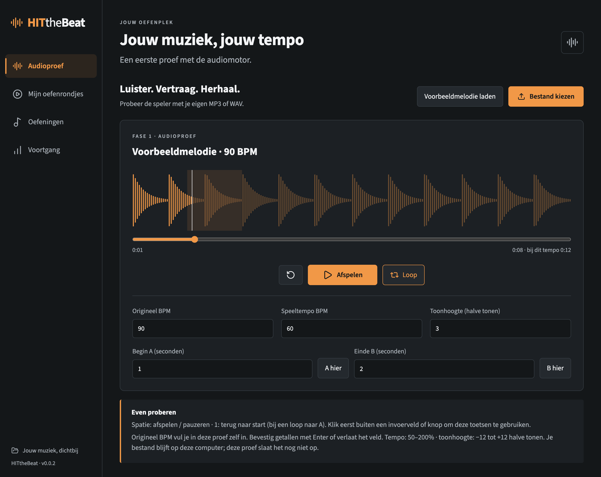

# Fase 1 — Audioproef

Datum: 10 oktober 2026. Proefversie: **0.0.2**. Status: gebouwd voor beoordeling; muzikale luistertest en Windows-gebruikstest staan open. De audio-engine is nog geen definitief geaccepteerde keuze voor alle oefenmateriaal.

## Proberen

Open de Mac-app in `release/mac-arm64/HITtheBeat.app` en kies **Audioproef**. Laad de voorbeeldmelodie (90 BPM) of een eigen MP3/WAV van maximaal 50 MB. Bestanden blijven alleen in het werkgeheugen van deze proef; er is nog geen bibliotheekopslag.

1. Vul bij eigen audio het oorspronkelijke BPM in. Automatische herkenning volgt in fase 3.
2. Pas speeltempo en toonhoogte afzonderlijk of samen aan. Bevestig getallen met Enter of door het veld te verlaten.
3. Stel A en B in met seconden of met ‘A hier’ en ‘B hier’. Schakel Loop in en speel af. De fragmentgrenzen zijn tijden in de brontrack.
4. Probeer pauze, zoeken en opnieuw starten, ook bij aangepast tempo. Spatie schakelt afspelen/pauzeren; 1 gaat naar de start, of naar A bij een actieve loop. Klik buiten knoppen/invoer voor deze sneltoetsen. Gefocuste knoppen behouden hun normale toetsenbediening.
5. Beluister eigen oefeningen met losse noten, akkoorden en ritmische passages. Let op klank bij 50%, 75%, 150% en 200%, en op tikken/gaten bij korte loops met verschillende grenzen. Deze luisterbeoordeling is nodig vóór verdere integratie.

Het proefbereik is 50–200% en −12 tot +12 halve tonen, met minimaal 0,1 seconde tussen A en B. Dit zijn experimentele grenzen, geen definitieve afspraak over ondersteunde klankkwaliteit. De proef bouwt nog geen oefenrondjes en toont nog geen tablatuur of opdrachtvak.

## Techniek en verificatie

- Signalsmith Stretch 1.3.2 via een lokaal meegeleverde AudioWorklet/WASM-module; de engine staat los van React in `src/audio/`.
- Geen remote scripts of blob-worklets. De CSP staat specifiek WASM-compilatie toe. De MIT-licentietekst wordt meegeleverd in `public/licenses/`.
- Afspeelpositie volgt de audioklok. Een GainNode sluit de uitvoer op het berekende trackeinde, onafhankelijk van tekentimers. Bij navigatie of nieuwe import wordt de oude AudioContext gesloten.
- Getalvelden bevestigen pas bij Enter/focusverlies. Wijzigingen worden als commando's achter elkaar uitgevoerd, zodat snelle invoer geen voorgaande instelling overschrijft.
- Een eigen synthetische voorbeeldmelodie wordt lokaal aangemaakt. De MP3-test gebruikt een ontwikkelafhankelijkheid (lamejs) om testaudio te genereren; deze encoder zit niet in de spelercode.

Automatische DSP-controle op de Mac: een testtoon van 440 Hz blijft bij 50%, 100% en 200% ongeveer 440–442 Hz; +12 halve tonen geeft 880 Hz bij gelijk tempo; 150% gecombineerd met −12 halve tonen geeft 220 Hz. De bronduur van 2 seconden wordt respectievelijk circa 4,04, 2,03 en 1,03 seconden. De meting omvat de verwerkingsstaart van de ongekorte engine. De app sluit de uitvoer op de berekende duur.

De looptest rendert 60 seconden met een bronfragment van 0,5 seconde en controleert RMS in opeenvolgende vensters op uitval. Dit bewijst continuïteit van synthetische audio, geen hoorbare klikvrijheid bij willekeurig muzikaal materiaal.

Desktoptests controleren offline laden van de voorbeeldmelodie, echte MP3-decodering, tempo-/toonhoogte-invoer, A/B-loop, ongeldige grenzen, pauze, opnieuw starten, einde van een track en opnieuw openen van het audioscherm. De bestaande tests controleren ook navigatie, lokale fonts en de geïsoleerde desktopkoppeling.

## Platformen en resterende acceptatie

Mac: macOS 27.0.1, Apple Silicon arm64. Automatische tests worden uitgevoerd op de ontwikkelapp en de verpakte Mac-app. Windows: x64-pakket gebouwd op de Mac; daadwerkelijk starten, toetsenbediening en audiokwaliteit op Windows moeten nog worden getest.

Nog open: muzikale luistertest door de gebruiker, klank en klikgedrag van verschillende korte loops, ondersteund kwaliteitsbereik en Windows-gebruikstest. Onderbreken/hervatten van een volledig oefenrondje volgt in fase 5. Fase 2 start na beoordeling van deze audioproef.

## Vastgelegde uitvoering

- TypeScript-controle en productiebuild: geslaagd.
- Routercontroles: 2 geslaagd.
- Ontwikkel-/desktoptests: 4 geslaagd, inclusief zes DSP-scenario’s.
- Verpakte Mac-app: audiobediening en offline desktopcontrole geslaagd; de twee bronmodule-/ontwikkeltests worden daar bewust overgeslagen.
- Pakketten: Mac arm64 en x64, Windows x64 en arm64 gebouwd. Alleen Mac arm64 is uitgevoerd en getest; de overige architecturen/platformen zijn niet gebruiksgetest.

## Vervolg in v0.0.3

Na deze proef heeft de gebruiker het bereik **25–300%** gekozen en opdracht gegeven verder te gaan. De oorspronkelijke 50–200%-grens hierboven beschrijft v0.0.2. Zie `FASE-2.md` voor de ruimere grensmetingen en nieuwe voorbeeldschermen. Muzikale luisterbeoordeling en Windows-gebruikstest blijven open.
