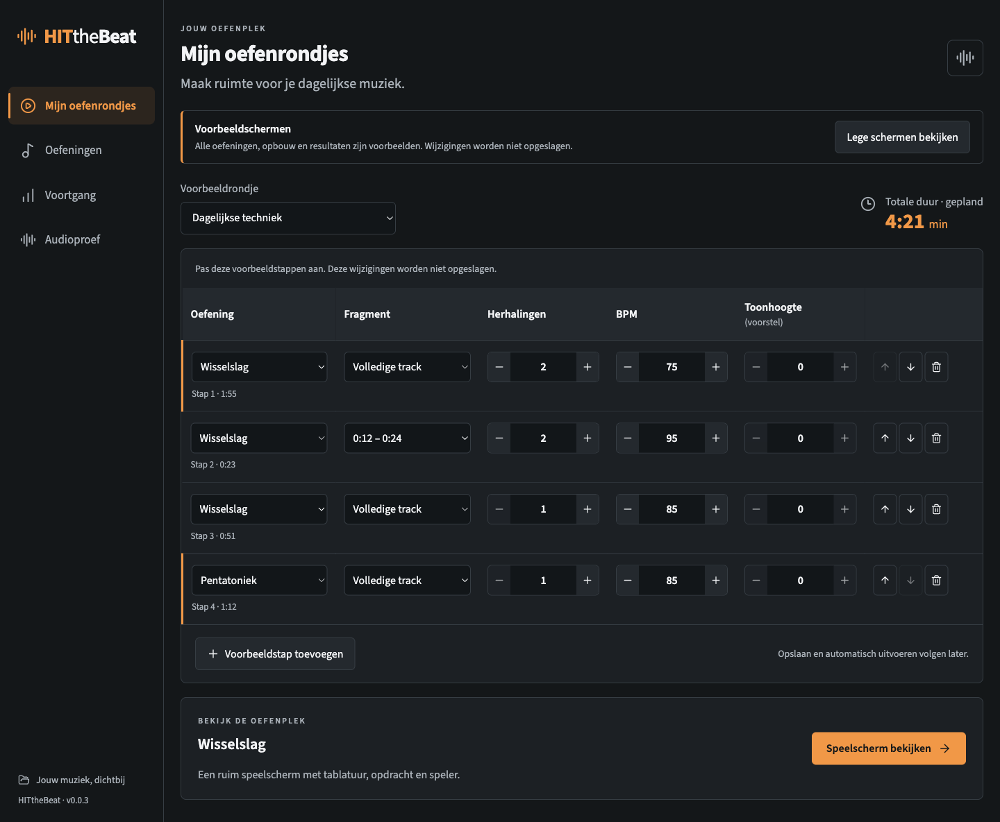
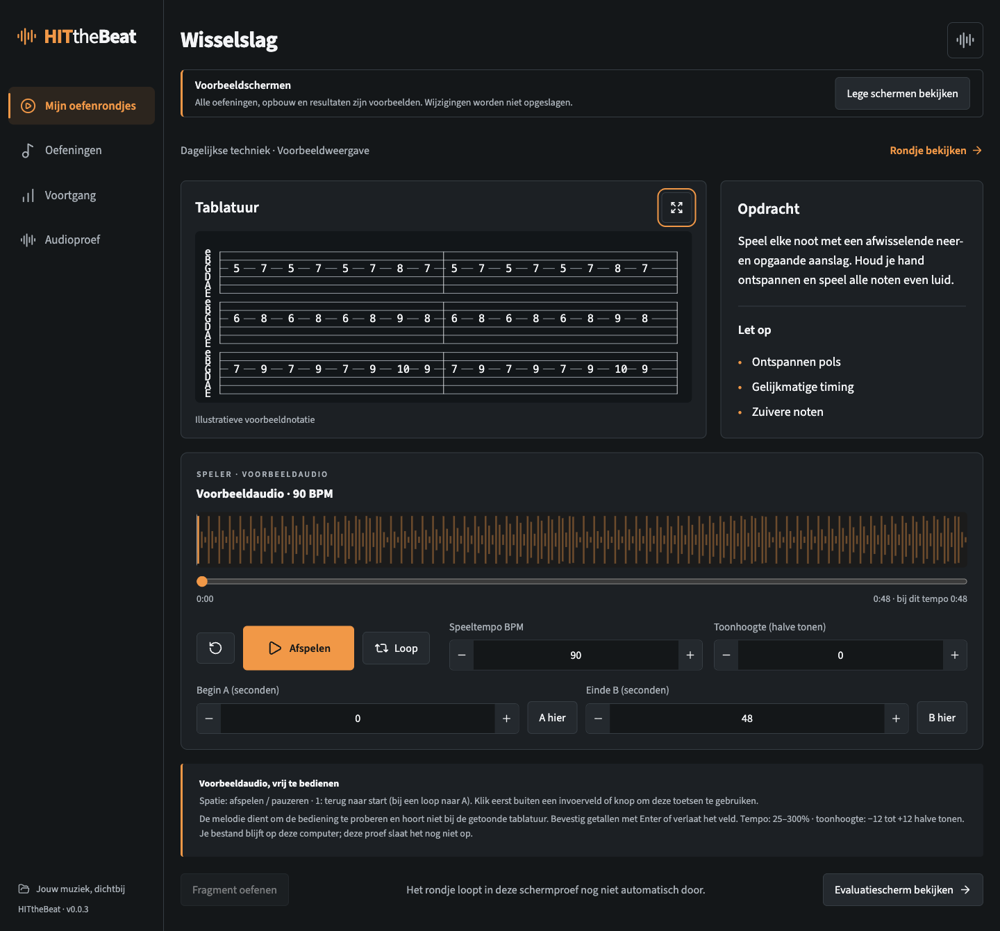
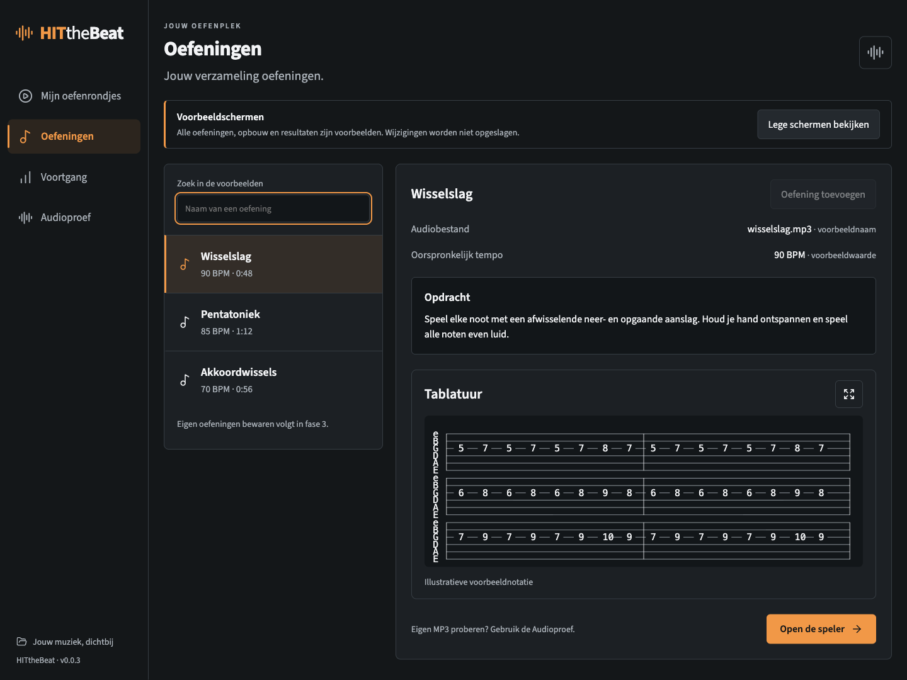
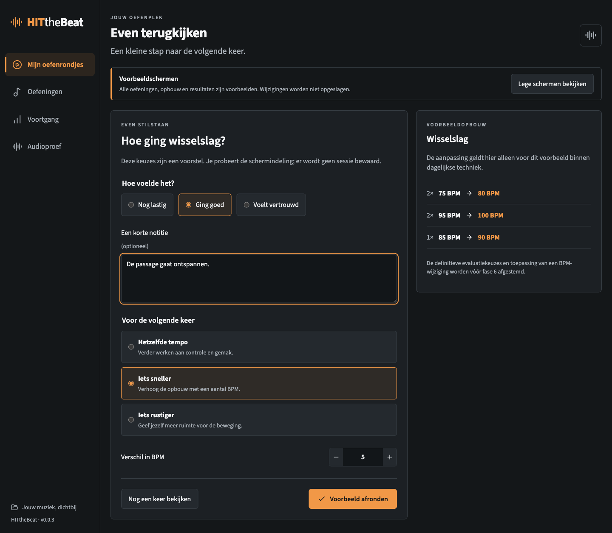
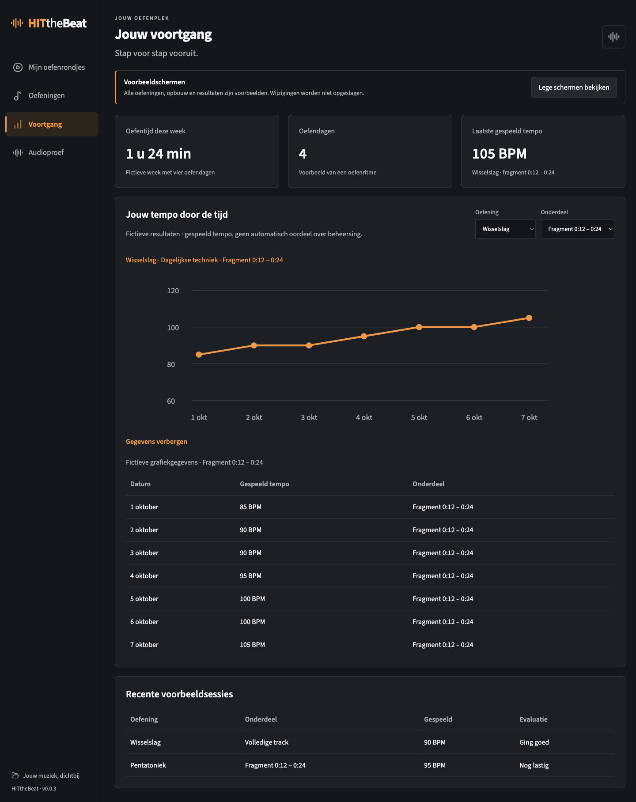

# Fase 2 — Doorloopbare schermen en tempo 25–300%

Datum: 10 oktober 2026. Proefversie: **0.0.3**. De gebruiker heeft het ruimere tempobereik gekozen en opdracht gegeven verder te gaan. Deze fase levert een interface voor beoordeling met fictieve voorbeelden; eigen bibliotheekopslag, BPM-herkenning en opgeslagen rondjes volgen later.

## Proberen

Open de Mac-app in `release/mac-arm64/HITtheBeat.app`.

1. **Mijn oefenrondjes:** pas herhalingen en BPM aan met typen of min/plus. Bevestig getallen met Enter of verlaat het veld. De totale duur rekent mee. Kies een fragment, voeg een voorbeeldstap toe of verplaats/verwijder een stap. Wissel tussen ‘Dagelijkse techniek’ en ‘Warming-up’ om de verschillende opbouwen te bekijken. Een ander voorbeeldrondje kiezen herstelt diens beginwaarden.
2. **Speelscherm bekijken:** bekijk de verdeling van tablatuur, opdracht en speler. Vergroot de tablatuur en sluit met Escape. De speler laadt een opgewekte voorbeeldmelodie, maar start pas op jouw afspeelcommando. Deze melodie hoort niet bij de illustratieve notatie.
3. **Oefeningen:** kies Pentatoniek om een lange opdracht te bekijken, of Akkoordwissels voor een oefening zonder tablatuur. De speler past de indeling daarop aan.
4. **Evaluatiescherm bekijken:** probeer de voorgestelde keuzes en BPM-aanpassing. De nieuwe opbouw is uitsluitend een voorbeeld; ‘Voorbeeld afronden’ bewaart niets. De definitieve keuzes worden vóór fase 6 afgestemd.
5. **Voortgang:** bekijk fictieve resultaten voor een volledige track of fragment. ‘Gegevens tonen’ maakt de grafiek ook als tabel leesbaar. Deze gegevens veranderen niet door de voorbeeld-evaluatie.
6. **Lege schermen bekijken:** bekijk de eerste-gebruikstoestanden. Wisselen naar de lege schermen of Audioproef kan tijdelijke voorbeeldwijzigingen resetten.
7. **Audioproef:** laad een eigen MP3 en probeer 25–300%. Bij 120 BPM kun je bijvoorbeeld 30, 60, 120, 240 en 360 BPM kiezen. Beoordeel de klank van losse noten, akkoorden en ritmische passages, ook bij korte loops.

Toonhoogte per tabelrij staat zichtbaar als voorstel en is niet actief. ‘Fragment oefenen’ is nog niet aangesloten op rondje-uitvoering; A/B-loopen kan wel vrij in de speler. Automatisch rondjes uitvoeren en onderbreken/hervatten volgen in fase 5.

## Wat werkt en wat nog volgt

De voorbeeldtabel rekent met `(fragmentduur of trackduur) × bron-BPM / doel-BPM × herhalingen`. Bijvoorbeeld: een track van 48 s bij 90 BPM duurt op 75 BPM 57,6 s. De eerste voorbeeldopbouw duurt afgerond 3:23; één extra herhaling van de eerste stap maakt dit 4:21. Deze tabelproef gebruikt hele BPM; de audioproef accepteert ook decimalen om de procentgrenzen precies te proberen.

Alle voorbeelden zijn fictief en lokaal meegeleverd. Er wordt geen bibliotheek, rondje of beoordeling opgeslagen en er draait nog geen automatische BPM-analyse. De voorbeeldspeler en Audioproef gebruiken dezelfde audio-engine. Tablatuur is een lokaal getekende illustratie; er zijn geen persoonlijke bestanden gecommit.

## Controle

De audiometing omvat de bestaande scenario’s plus 25% en 300%, ook gecombineerd met een octaaf transpositie. Een 440Hz-bron blijft rond 440 Hz op de nieuwe grenzen. +12 halve tonen bij 25% geeft circa 880 Hz; −12 bij 300% geeft 220 Hz. Een bron van 2 s duurt circa 8 s respectievelijk 0,667 s. De ongekorte engine kan een verwerkingsstaart hebben (gemeten circa 0,17–0,19 s bij 25%); de app begrenst de uitvoer op de berekende duur met de audioklok. Dit is geen luisteroordeel over echte muziek.

De schermtest doorloopt bewerken van de tabel en duurberekening, ongeldige invoer, toevoegen/verplaatsen/verwijderen, speler, vergrote tablatuur en Escape, evaluatievoorbeeld, dashboardcontext en datatabel, bibliotheekzoeken, lange opdracht, ontbrekende tablatuur en vensterbreedte 960 px. De brede tabel heeft een eigen horizontale scroll; de pagina zelf hoort niet horizontaal te scrollen. De tests controleren ook contrast van de gebruikte secundaire tekstkleur op het verhoogde paneel (>4,5:1).

Mac-testomgeving: macOS 27.0.1, Apple Silicon arm64. Een Windows-cross-build is geen Windows-gebruikstest. Muzikale klankkwaliteit en Windows-werking blijven expliciet open. De volgende inhoudelijke fase is eigen oefeningen importeren en bewaren met BPM-herkenning, na feedback op deze schermen.

Automatische ontwikkelcontroles: TypeScript/productiebuild geslaagd; 2 routercontroles en 5 desktoptests geslaagd. De DSP-test omvat 12 scenario’s, waaronder loops van 60 seconden op 25%, 100% en 300%. Bij 25% verandert de gemeten amplitude sterker; muzikale luisterbeoordeling blijft daarom nodig. De afspeelknop staat bij de geteste brede venstergrootte binnen het eerste scherm, met aanvullende instellingen daaronder.

## Schermbeelden

## Verpakte app

De Mac-arm64-app is afzonderlijk getest: drie desktoptests geslaagd (audio, voorbeeldschermen en offline shell); twee bronmodule-/ontwikkeltests worden daar bewust overgeslagen. Het Mac-zipbestand staat in `release/HITtheBeat-0.0.3-mac-arm64.zip`. Het Windows-x64-proefpakket is eveneens lokaal gebouwd (`release/HITtheBeat-0.0.3-win-x64.zip`); dit moet nog op Windows worden uitgevoerd. Pakketten worden niet in Git opgeslagen.
